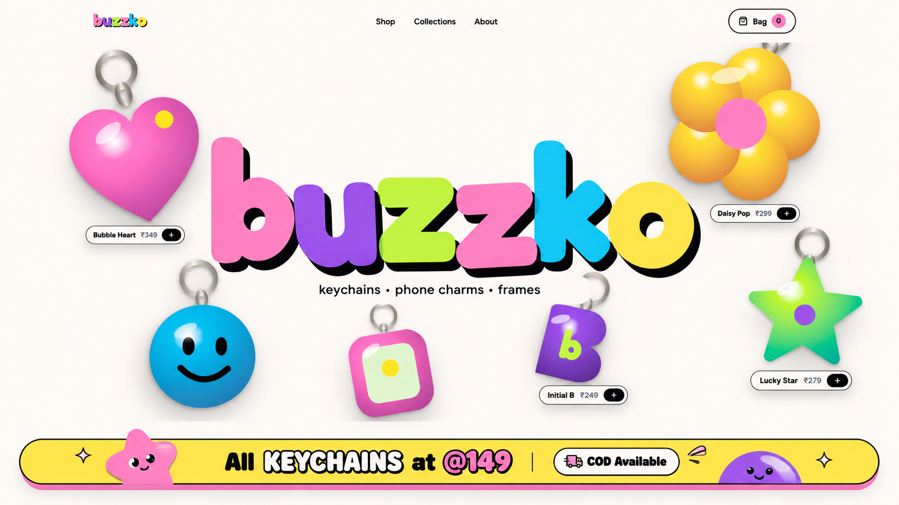
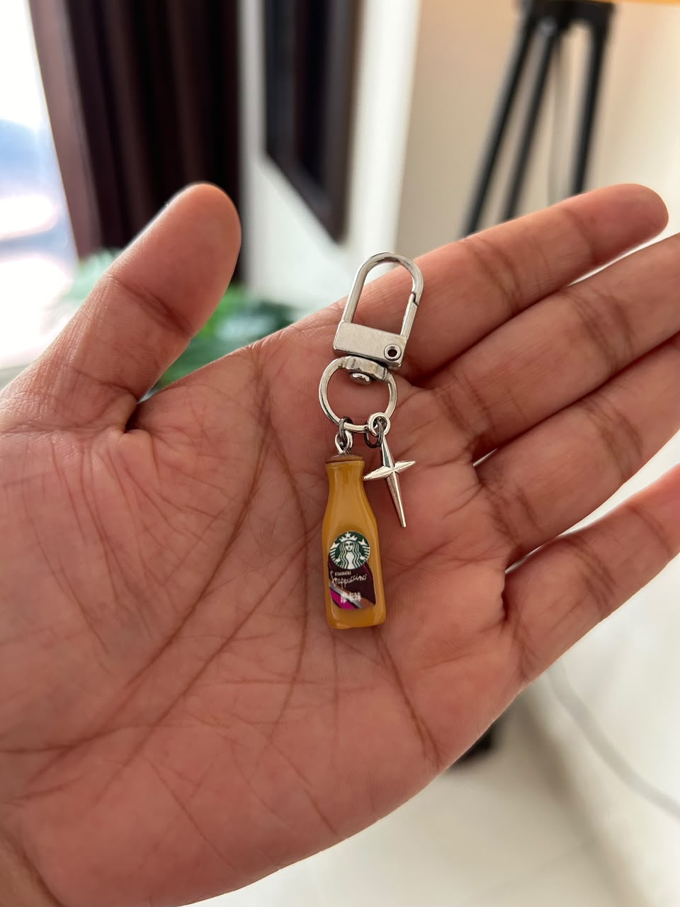
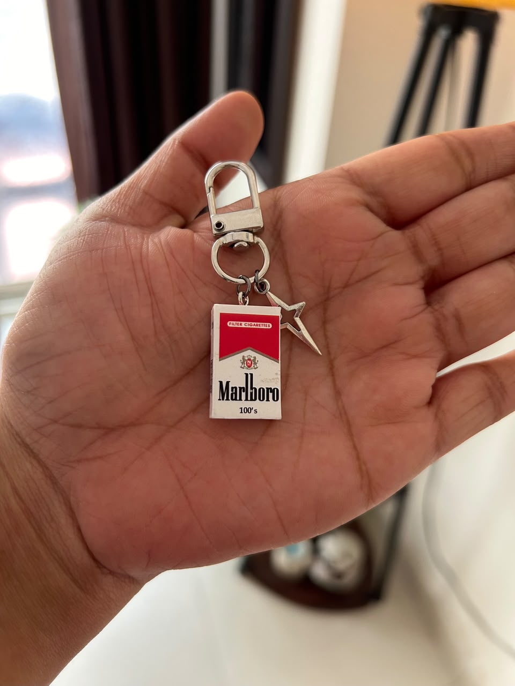
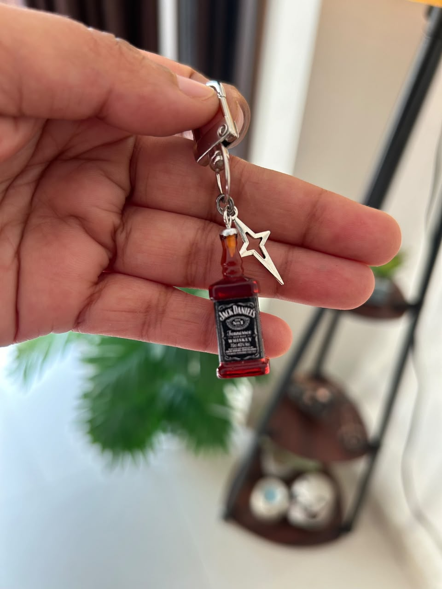
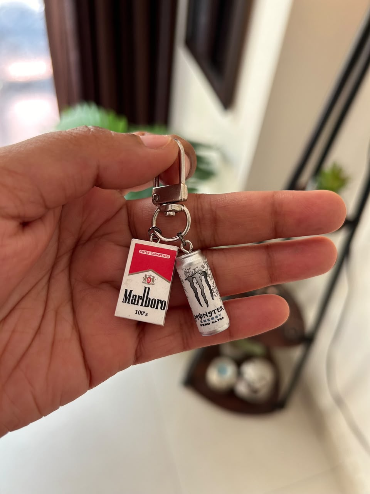

# 🐝 buzzko — Handcrafted Keychains & Charms

> **Tiny objects with big personality.** Designed to dangle, clip, collect and swap — made in small batches.

[](https://surajit00007.github.io/Buzzko_website/)
[](https://github.com/Surajit00007/Buzzko_website/releases/tag/v1.1)
[](https://wa.me/919625924179)
[](https://www.instagram.com/buzz.ko/)

---

<p align="center">
  
</p>

---

## 🎬 Promotional Video (Content Posting / Reels / Shorts)

Download and post our official 9:16 HD vertical animated reel across Instagram Reels, TikTok, YouTube Shorts, and WhatsApp Status:

<p align="center">
  <video src="https://raw.githubusercontent.com/Surajit00007/Buzzko_website/main/public/buzzko-promo.webm" width="380" controls autoplay loop muted>
    Your browser does not support the video tag.
  </video>
</p>

- 📥 **[Download High-Definition Promo Video (.webm)](public/buzzko-promo.webm)**
- 📁 Backup copy stored in `Assets/buzzko-promo.webm`
- 🎞️ Format: **1080×1920 (9:16 Vertical Reel)**, 60fps with brand animations, product showcase, and WhatsApp/Instagram CTA.

---

## 📸 Website Previews & Screenshots

### 1. Interactive Storefront & Floating Charms Stage
An interactive floating hero stage with tilt animations, product tags, and 1-click bag additions:

<p align="center">
  
</p>

### 2. Handcrafted Product Collections
Glossy resin, enamel, and acrylic keychains, phone charms, and mini frames:

| Bubble Heart | Daisy Pop | Lucky Star | Smiley Club |
|:---:|:---:|:---:|:---:|
|  |  |  |  |
| **Puffy Resin Heart** | **Sunny Enamel Flower** | **Chunky Acrylic Star** | **Good-Energy Smiley** |
| ₹149 | ₹149 | ₹149 | ₹149 |

### 3. Contact & Delivery Checkout
Direct Cash On Delivery (COD) details collection that converts directly into a pre-filled WhatsApp order:

<p align="center">
  
</p>

### 4. Admin Studio & Account Access
Secure authentication with admin role gates to manage products, prices, and upload cloud photos:

<p align="center">
  
</p>

---

## ✨ Features

- **🛍️ Dynamic Catalogue**: Real-time catalogue reading from Supabase Cloud with instant fallback charms.
- **👜 Persistent Bag Drawer**: Quantities persist across navigation with an animated toast bubble on every addition.
- **💬 Direct WhatsApp Orders**: Calculates live selling prices, discounts, and delivery addresses directly into a formatted WhatsApp order link (`https://wa.me/919625924179`).
- **🎨 Brand Authenticity**: Built with custom pastel typography (Fredoka & Figtree), original Instagram & Facebook vector badges, and responsive layouts.
- **🚀 Static Prerendered**: Prerendered for instant load times and deployed automatically to GitHub Pages.

---

## 🛠️ Tech Stack

- **Framework**: [TanStack Start](https://tanstack.com/start) + [TanStack Router](https://tanstack.com/router)
- **UI Library**: React 19 + TypeScript
- **Styling**: Tailwind CSS v4 + Radix UI primitives
- **Backend / DB**: Supabase (PostgreSQL + RLS + Storage)
- **Hosting**: GitHub Pages

---

## 💻 Local Development

1. **Clone the repository:**
   ```sh
   git clone https://github.com/Surajit00007/Buzzko_website.git
   cd Buzzko_website
   ```

2. **Install dependencies:**
   ```sh
   npm install
   ```

3. **Start local dev server:**
   ```sh
   npm run dev
   ```
   Open [http://localhost:8080](http://localhost:8080) in your browser.

4. **Run test suite:**
   ```sh
   npm run test
   ```

5. **Build for production:**
   ```sh
   npm run build
   ```

---

## 📱 Connect With Buzzko

- 🌐 **Live Website**: [surajit00007.github.io/Buzzko_website/](https://surajit00007.github.io/Buzzko_website/)
- 📸 **Instagram**: [@buzz.ko](https://www.instagram.com/buzz.ko/)
- 💬 **WhatsApp**: [+91 9625924179](https://wa.me/919625924179)
- 🎨 **Designed by**: [Surajit Sahoo](https://www.instagram.com/surajit_unfiltered/)
