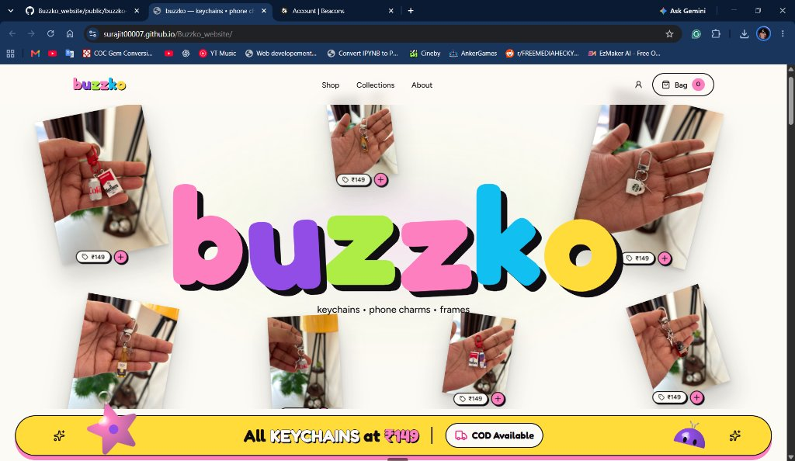
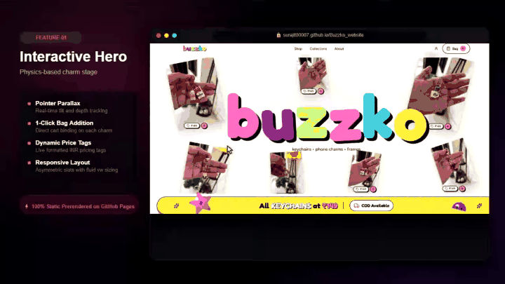
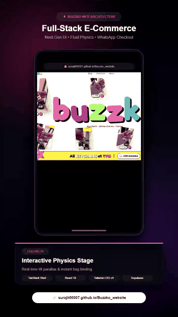

# 🐝 buzzko — Modern Full-Stack E-Commerce Website

> **A high-performance, statically prerendered e-commerce storefront engineered with TanStack Start, React 19, Tailwind CSS v4, and Supabase.**

[](https://surajit00007.github.io/Buzzko_website/)
[](https://github.com/Surajit00007/Buzzko_website/releases/tag/v1.1)
[](https://github.com/Surajit00007/Buzzko_website/actions)
[](https://react.dev/)
[](https://tanstack.com/start)
[](https://supabase.com/)

---

## 🌐 Live Storefront

The live storefront is deployed and accessible on GitHub Pages:
**[https://surajit00007.github.io/Buzzko_website/](https://surajit00007.github.io/Buzzko_website/)**

<p align="center">
  
</p>

---

## 🖥️ Website & Features Walkthrough Demo

A walkthrough demonstrating the desktop experience, interactive physics charm stage, dynamic bag drawer, cloud catalogue filters, and WhatsApp order handoff:

<p align="center">
  
</p>

### 📥 Video Downloads & Formats
- 🎬 **[Download MP4 Video (1080p / 720p HD)](public/buzzko-website-demo.mp4)** *(Compatible with Windows, Mac, iOS, Android, and video editors)*
- 🎞️ **[Download WebM Video (High Quality)](public/buzzko-website-demo.webm)**
- 📁 Backup copies also stored in `Assets/buzzko-website-demo.mp4` and `Assets/buzzko-website-demo.webm`.

---

## 📱 Mobile UI Promotional Reel (For Social Media Content Posting)

Specially formatted for content posting on **Instagram Reels, TikTok, YouTube Shorts, and WhatsApp Status** to showcase the mobile responsive web app, touch interactions, and UI architecture:

<p align="center">
  
</p>

### 📥 Reel Video Downloads
- 🎬 **[Download Mobile Reel (MP4 9:16 Vertical HD)](public/buzzko-feature-reel.mp4)** *(Ready to upload to Instagram Reels / YouTube Shorts)*
- 🎞️ **[Download Mobile Reel (WebM 9:16 Vertical)](public/buzzko-feature-reel.webm)**
- 📁 Backup copy stored in `Assets/buzzko-feature-reel.mp4`

---

## 📸 Website Previews & Screenshots

### 1. Interactive Physics Charm Stage (Hero)
An interactive floating charm stage with pointer parallax, real-time depth perspective, responsive asymmetric layout slots, and instant 1-click bag binding.

<p align="center">
  
</p>

---

### 2. Live Cloud Catalogue & Filter Chips
Instant category filtering (*All*, *Keychains*, *Charms*), dynamic strikethrough pricing calculations, modal high-resolution image zoom inspection, and an OfferStrip banner that conditionally renders only when catalogue prices match promotion criteria.

<p align="center">
  
</p>

---

### 3. Zod-Validated WhatsApp Checkout Workflow
Zero-friction checkout flow featuring strict client-side validation (Indian mobile numbers, 6-digit postal PIN codes, state, and address), cash-on-delivery preferences, and an automated handoff that generates a pre-formatted itemised WhatsApp order message.

<p align="center">
  
</p>

---

### 4. Admin Studio & Secure Cloud Infrastructure
Protected management portal backed by PostgreSQL Row Level Security (RLS) policies, private cloud bucket signed URLs, and admin role isolation ensuring public visitors cannot mutate catalogue state.

<p align="center">
  
</p>

---

## ⚡ Core Website & Architecture Features

| Feature | Technical Implementation | Benefit |
| :--- | :--- | :--- |
| **Interactive Physics Stage** | Dynamic CSS 3D transforms, mouse/touch tracking, fluid viewport units | Engaging sensory micro-interactions without heavy WebGL bundles |
| **Reactive Bag Drawer** | React Context + LocalStorage sync + animated Sonner toasts | Frictionless 1-click bag additions that persist across sessions |
| **Smart Price Normalization** | Shared pricing helpers (`sellingPrice`, `bagSubtotal`, `savings`) | Consistent discounts, strikethrough pricing, and bag totals |
| **WhatsApp Order Handoff** | Shared order helper + WhatsApp click-to-chat URL encoder | Immediate conversion without third-party payment gateway fees |
| **Strict Form Validation** | Zod schema validation for Indian phones, PIN codes & shipping details | Prevents malformed orders and eliminates delivery failure rates |
| **Static SSR Prerendering** | TanStack Start crawler + Nitro static prerender + GitHub Pages | Blazing-fast TTFB, zero server hosting costs, 100% SEO indexability |
| **Database Security (RLS)** | Supabase PostgreSQL with protected `user_roles` table | Defense-in-depth: writes enforced at the database level |

---

## 🛠️ Tech Stack & Tooling

- **Core Framework**: [TanStack Start](https://tanstack.com/start) with static prerendering (`prerender: { enabled: true }`)
- **Routing**: [TanStack Router](https://tanstack.com/router) with strict type safety and subpath basepath routing
- **UI Engine**: React 19 + TypeScript
- **Styling**: Tailwind CSS v4, Lucide React icons, and Radix UI dialog primitives
- **Typography**: Fredoka (chunky playful headers) & Figtree (clean ergonomic body text)
- **Backend & Auth**: [Supabase](https://supabase.com) (PostgreSQL, Row Level Security, Storage)
- **Testing**: Vitest + React Testing Library (27/27 unit & integration tests passing)
- **CI / CD**: GitHub Actions deploying automatically to GitHub Pages (`gh-pages` branch)

---

## 💻 Local Development & Testing

1. **Clone the repository:**
   ```bash
   git clone https://github.com/Surajit00007/Buzzko_website.git
   cd Buzzko_website
   ```

2. **Install dependencies:**
   ```bash
   npm install
   ```

3. **Start the local dev server:**
   ```bash
   npm run dev
   ```
   Open `http://localhost:8080` in your browser.

4. **Run unit tests:**
   ```bash
   npm run test
   ```

5. **Build and prerender static pages:**
   ```bash
   npm run build
   ```

6. **Regenerate promotional feature media:**
   ```bash
   node scripts/generate-website-demo.mjs   # Generates 16:9 desktop walkthrough
   node scripts/generate-promo-video.mjs    # Generates 9:16 vertical mobile reel
   python scripts/convert_media.py          # Encodes MP4 and creates looping GIFs
   ```

---

## 🚀 Live Links & Socials

- 🌐 **Live Website**: [https://surajit00007.github.io/Buzzko_website/](https://surajit00007.github.io/Buzzko_website/)
- 📦 **GitHub Releases**: [v1.1 Release Notes](https://github.com/Surajit00007/Buzzko_website/releases/tag/v1.1)
- 📸 **Instagram**: [@buzz.ko](https://www.instagram.com/buzz.ko/)
- 💬 **WhatsApp Store**: [+91 9625924179](https://wa.me/919625924179)
